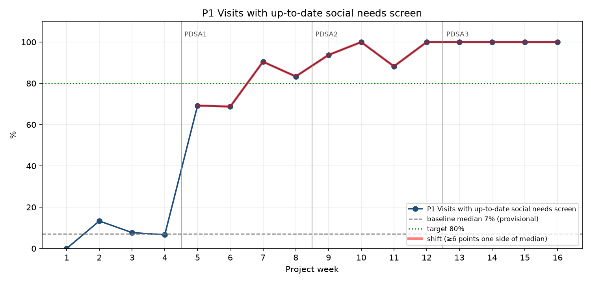
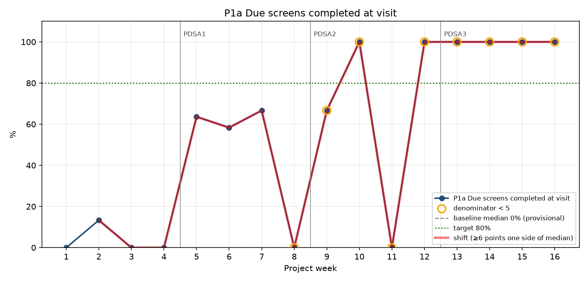
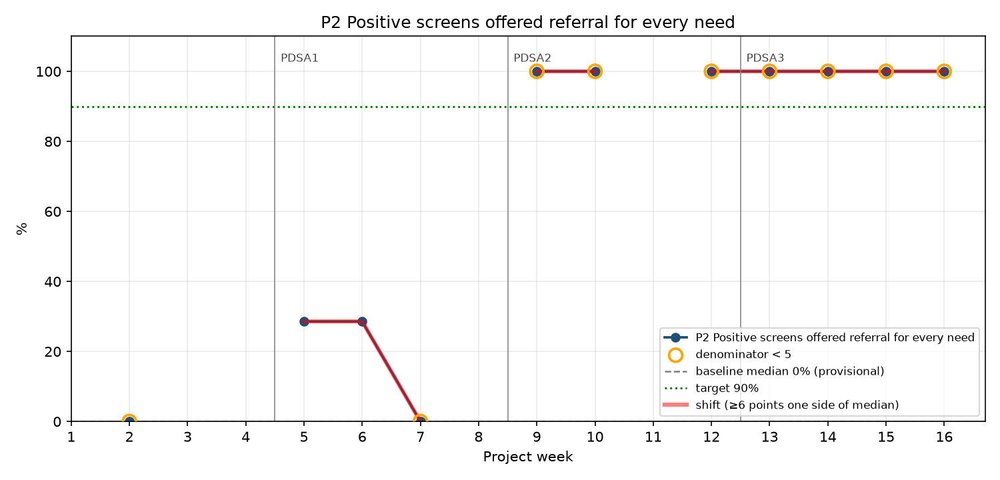
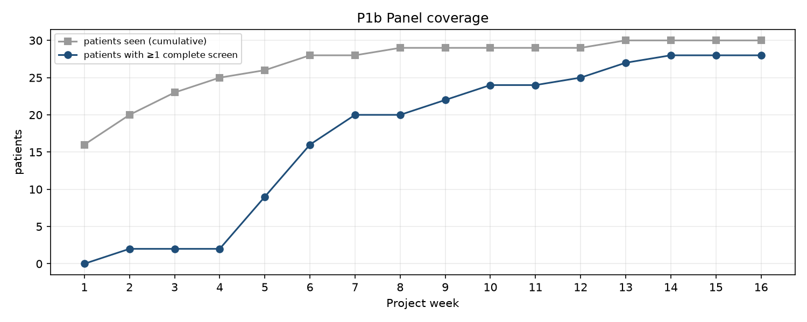

# QI Measure Summary

> ⚠️ **SYNTHETIC DATA — for demonstration only. Not real patients; do not cite.**

Data: `data/synthetic` · visits: 245 (4 excluded) · patients: 30 · weeks: 1–16 · referrals: 65

Validation issues: 0

## Run chart signals (Perla et al. 2011 rules)
- **P1** (baseline median 7%): shift above median, weeks 5–16
- **P1a** (baseline median 0%): shift above median, weeks 2–16
- **P2** (baseline median 0%): shift above median, weeks 5–16

## Baseline vs. intervention (descriptive, Wilson 95% CI)
| measure | period | num | den | pct | 95% CI |
|---|---|---|---|---|---|
| P1 up-to-date screen | baseline | 4 | 63 | 6% | 2%–15% |
| P1a due-screen completed | baseline | 2 | 61 | 3% | 1%–11% |
| P2 referral offered (all positive domains) | baseline | 0 | 2 | 0% | 0%–66% |
| B1 declined (due visits) | baseline | 1 | 61 | 2% | 0%–9% |
| P1 up-to-date screen | intervention | 162 | 178 | 91% | 86%–94% |
| P1a due-screen completed | intervention | 28 | 44 | 64% | 49%–76% |
| P2 referral offered (all positive domains) | intervention | 14 | 28 | 50% | 33%–67% |
| B1 declined (due visits) | intervention | 4 | 44 | 9% | 4%–21% |

**B2 Screening time:** median 7 min (IQR 6–8), n=30

## Follow-up (accepted referrals ≥ 30 days old, grouped by phase of referral)
| phase | accepted | documented | connected | O1 | O2 |
|---|---|---|---|---|---|
| baseline | 8 | 1 | 1 | 12% | 12% |
| pdsa1 | 23 | 6 | 5 | 26% | 22% |
| pdsa2 | 11 | 4 | 2 | 36% | 18% |
| all | 42 | 11 | 8 | 26% | 19% |

## Referral funnel
| step | count |
|---|---|
| Positive actionable domains (complete screens) | 75 |
| Referrals offered | 57 |
| Referrals accepted | 45 |
| Follow-up documented (any time) | 12 |
| Connected | 8 |

## Need prevalence (latest complete screen per patient)
| domain | patients | of | pct |
|---|---|---|---|
| Housing unstable/at risk | 25 | 28 | — |
| Housing quality problem (of those with housing) | <5 | 4 | — |
| Food | 22 | 28 | 79% |
| Transportation | 14 | 28 | 50% |
| Utilities (of those with housing) | <5 | 4 | — |
| Interpersonal safety (of those asked privately) | <5 | 22 | — |
| Safety deferred (no privacy) | 6 | 28 | 21% |
| Health literacy | 10 | 28 | 36% |
| ID/documents | 5 | 28 | 18% |

P1b panel coverage at final week: 28/30 patients.

## Weekly data
| week | phase | visits | P1 | due | P1a | p2_den | P2 | B1 |
|---|---|---|---|---|---|---|---|---|
| 1 | baseline | 20 | 0% | 20 | 0% | 0 | — | 0% |
| 2 | baseline | 15 | 13% | 15 | 13% | 2 | 0% | 0% |
| 3 | baseline | 13 | 8% | 12 | 0% | 0 | — | 0% |
| 4 | baseline | 15 | 7% | 14 | 0% | 0 | — | 7% |
| 5 | pdsa1 | 13 | 69% | 11 | 64% | 7 | 29% | 9% |
| 6 | pdsa1 | 16 | 69% | 12 | 58% | 7 | 29% | 17% |
| 7 | pdsa1 | 21 | 90% | 6 | 67% | 4 | 0% | 17% |
| 8 | pdsa1 | 12 | 83% | 2 | 0% | 0 | — | 0% |
| 9 | pdsa2 | 16 | 94% | 3 | 67% | 2 | 100% | 0% |
| 10 | pdsa2 | 9 | 100% | 2 | 100% | 2 | 100% | 0% |
| 11 | pdsa2 | 17 | 88% | 2 | 0% | 0 | — | 0% |
| 12 | pdsa2 | 16 | 100% | 1 | 100% | 1 | 100% | 0% |
| 13 | pdsa3 | 14 | 100% | 2 | 100% | 2 | 100% | 0% |
| 14 | pdsa3 | 17 | 100% | 1 | 100% | 1 | 100% | 0% |
| 15 | pdsa3 | 13 | 100% | 1 | 100% | 1 | 100% | 0% |
| 16 | pdsa3 | 14 | 100% | 1 | 100% | 1 | 100% | 0% |
